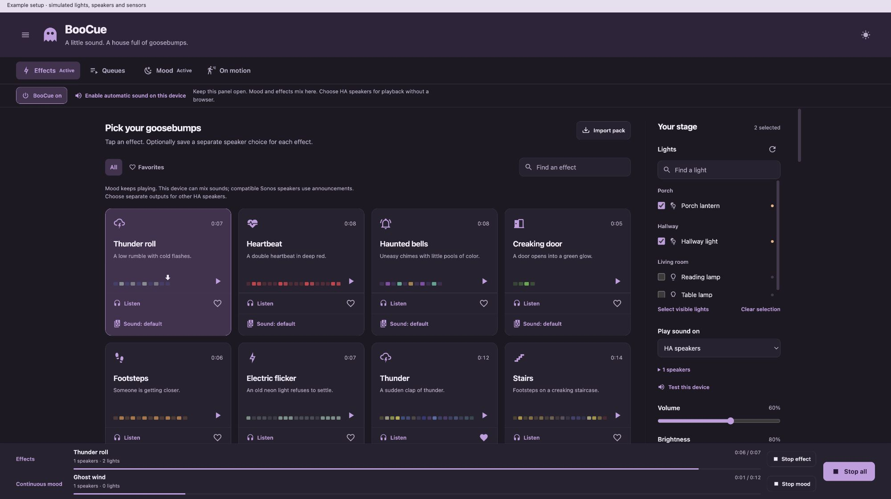
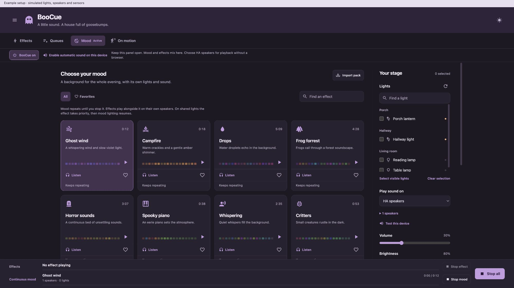
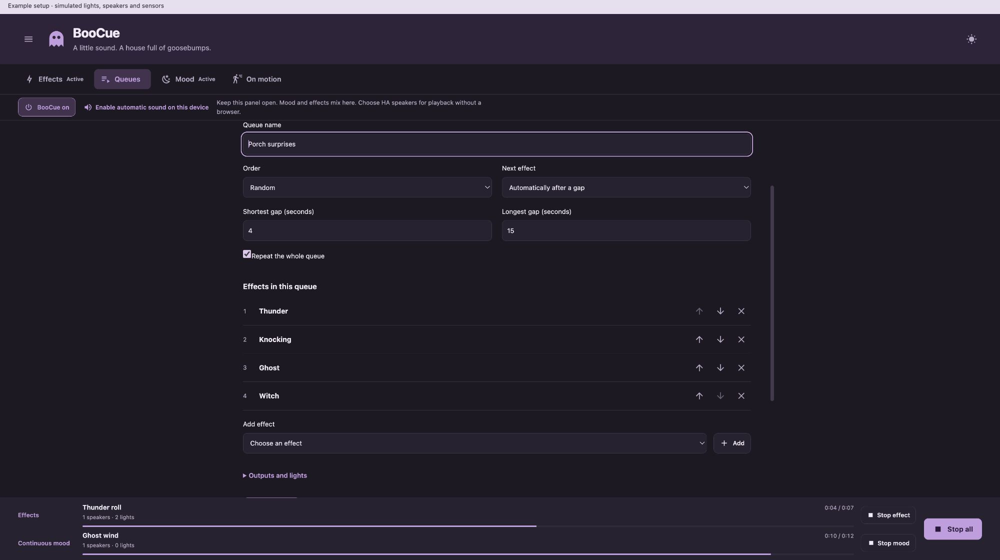
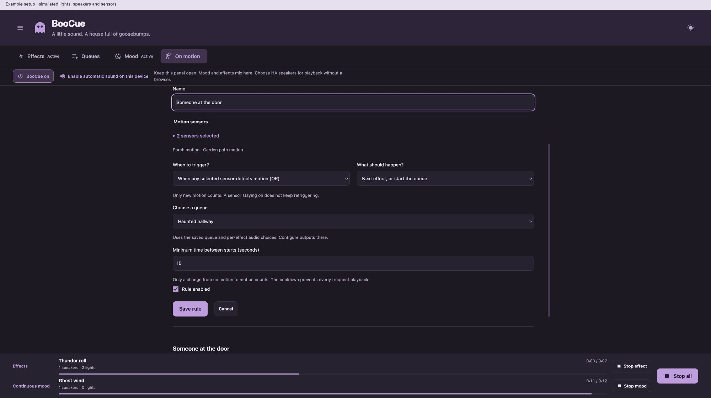
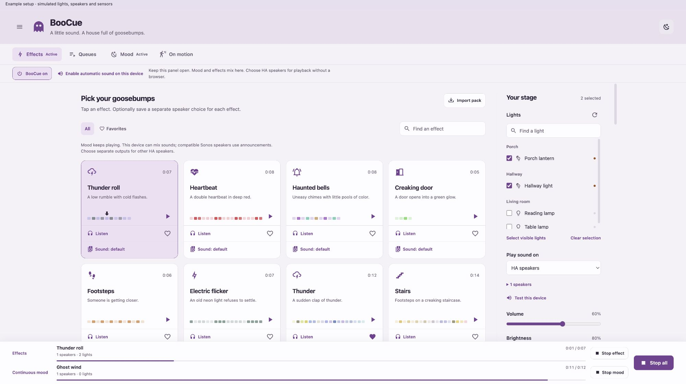
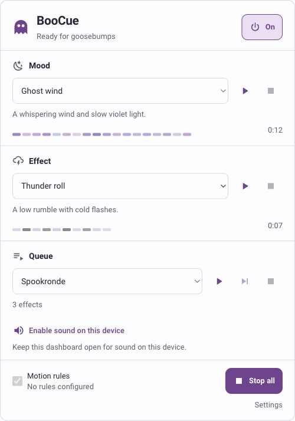

# BooCue

*A little sound. A house full of goosebumps.*

BooCue turns your Home Assistant lights and speakers into a Halloween soundboard. Choose the lights, choose where the sound plays, and start an effect. Keep rain or spooky music playing in the background while thunder, footsteps or a scream interrupts the scene with its own light sequence.

[](https://github.com/dwainscheeren/boocue/releases/latest)
[](https://github.com/dwainscheeren/boocue/actions/workflows/ci.yml)
[MIT code](LICENSE) · [Asset terms](ASSETS.md) · Home Assistant 2026.8.0+



## What does it do?

| You want to… | BooCue does this |
| --- | --- |
| Set the scene | **Mood** loops a background atmosphere with its own lights, speaker targets and volume. |
| Add a scare | **Effects** plays a short sound and its matching light sequence over the background scene. |
| Let it run | **Queues** plays your chosen effects in a fixed order or shuffle, with repeat and a random pause between items. |
| React to visitors | **On motion** uses one or more sensors to play an effect, start a queue or advance to the next item. |
| Control it from a dashboard | The included **Lovelace card** offers master power, mood, effects, favorites and queue controls. |
| Use existing automations | Native HA entities and actions let you add schedules, doorbells, presence or other conditions. |

Works with Philips Hue **and other Home Assistant lights**, including color, dimmable and on/off lights. No Hue bridge is required by BooCue itself; your lights and speakers use their existing HA integrations. Playback and scheduling run locally in Home Assistant; the chosen media player may have its own network requirements.

## A look around

The screenshots use example devices. The panel and dashboard card support light and dark themes and English/Dutch controls.

| Continuous atmosphere | Your own effect sequence |
| --- | --- |
|  |  |

| Motion rules | Light mode |
| --- | --- |
|  |  |

<details>
<summary>See the compact Home Assistant dashboard card</summary>



The card is included with the integration. It can use your saved targets or its own light/speaker overrides. See [card configuration](docs/DASHBOARD.md).

</details>

## Install

Requires **Home Assistant 2026.8.0 or newer** and an administrator account for the panel, card and actions.

### HACS

BooCue is a custom repository, so add it to HACS first:

1. Open **HACS → ⋮ → Custom repositories**.
2. Add `https://github.com/dwainscheeren/boocue` with type **Integration**.
3. Find **BooCue**, download it and restart Home Assistant.
4. Go to **Settings → Devices & services → Add integration → BooCue**.

See the [HACS custom-repository guide](https://www.hacs.dev/docs/faq/custom_repositories/) for the menu details.

### Manual

Download the ZIP from the [latest release](https://github.com/dwainscheeren/boocue/releases/latest). Put its `boocue` folder inside `<config>/custom_components/`, restart Home Assistant and add the integration as above.

The final path is `<config>/custom_components/boocue/manifest.json`. For an update, replace that integration folder and refresh your browser. Settings and imported packs are stored separately in the HA configuration directory.

## Your first show

1. Open **BooCue** in the HA sidebar. Under **Effects**, select one or more lights and choose **This device**, **HA speakers** or **No sound** as the output.
2. Tap an effect such as **Thunder**. Its audio and light sequence start together; the arrow above the color blocks follows the active part of the timeline. Optional virtual demo lights let you try it without physical lamps.
3. Open **Mood**, choose an atmosphere such as **Rain**, select its own destinations and press Play. It keeps looping while effects come and go.
4. Create a queue or motion rule when you want automatic scares. Use the same browser, separate HA speakers or compatible Sonos announcement targets for overlapping atmosphere and effects.

**Listen** previews the sound on the current device. **Play** runs the effect using the selected lights and output. The color timeline shows intended cue colors; it does not measure what a physical bulb is displaying.

### Put BooCue on a dashboard

Choose **Add card → BooCue**, or add:

```yaml
type: custom:boocue-card
```

The integration registers the card automatically; there is no second frontend repository to install. Its visual editor controls the title, theme, visible sections and per-channel targets. [See all card options](docs/DASHBOARD.md).

## Three ways to use it

**A haunted porch:** loop rain on a background speaker, select the porch lamps, then shuffle thunder, knocking and ghost sounds with a 4–15 second pause. The mood continues between effects.

**A walk-through scene:** save an ordered queue, choose **Wait for motion / Next**, and connect a motion rule to **Next item / start queue**. Each new movement starts or advances the sequence. Combine two sensors with OR or AND and set a cooldown.

**A Halloween dashboard:** use the master switch to allow or block all BooCue playback, select a mood and effect from the compact card, and use Play/Next/Stop for your saved queue. HA automations can arm motion rules only at certain times.

Follow the [step-by-step examples](docs/EXAMPLES.md) for these setups and ready-to-adapt automation YAML.

## Lights, speakers and control

Mood and foreground effects have independent settings. An effect can also remember its own speaker targets and volume. Shared lights follow the foreground effect temporarily and then return to the mood. When restoration is enabled, stopping restores the previous light state.

| Sound output | What to expect |
| --- | --- |
| **This device** | The browser mixes mood and effects and lowers the mood during an effect. Enable audio with a click and keep the page open. |
| **Compatible Sonos targets** | Announcements can play foreground effects over background audio. Availability depends on the HA player integration and its capabilities. |
| **Other HA speakers** | Use different destinations for overlapping mood and effects. Server playback continues without an open browser. |
| **No sound** | Run the light sequence only. |

Device buffering, networks and lamp response affect synchronization; adjust the light delay if needed. Generic speaker loops can have gaps, and previous music queues are not restored. By default, light commands are limited to one update per 250 ms. Browser audio can be suspended when a mobile device locks or backgrounds the page.

The master switch **Off** stops everything and blocks new starts. **On** allows future starts. **Stop all** stops playback and disarms motion rules; stopping only the effect or queue leaves the mood running. Playback does not resume automatically after an HA restart. Manual lamp changes during a show may be replaced when the saved light state is restored; a forced shutdown can prevent that cleanup.

Native controls include `switch.boocue_enabled`, `switch.boocue_automatic`, `binary_sensor.boocue_active`, stop/next buttons and playback status sensors. See [entities and automation actions](docs/AUTOMATIONS.md).

## Sounds included

**54 foreground effects + 14 background atmospheres = 68 sounds**, ready to use after installation. They include thunder, footsteps, creaking doors, ghost voices, rain, forests, piano and bells.

Every recording lives in [`assets/audio`](custom_components/boocue/assets/audio), with one shared catalog at [`assets/pack.json`](custom_components/boocue/assets/pack.json). The original eight demos and the additional 60 recordings have different [asset terms](ASSETS.md).

You can also import your own ZIP containing `pack.json` and audio. WAV, MP3, OGG, FLAC and M4A are supported. Imported packs stay in `<config>/boocue/packs/` and survive integration updates. Unchanged copies of bundled sounds are recognized without duplicate entries. [Create an effect pack](docs/EFFECT_FORMAT.md).

## Documentation

| Guide | Contents |
| --- | --- |
| [Example setups](docs/EXAMPLES.md) | Background mood, automatic scares, motion queues and HA YAML. |
| [Dashboard card](docs/DASHBOARD.md) | Visual editor, card options and output overrides. |
| [Automations](docs/AUTOMATIONS.md) | Native entities, action reference, sensor rules and playback behavior. |
| [Effect format](docs/EFFECT_FORMAT.md) | Audio files, timed light cues and pack limits. |
| [Contributing](CONTRIBUTING.md) | Project layout, local checks, preview and release packaging. |
| [Asset terms](ASSETS.md) | Sound, cue and icon licenses. |

## License

Code, documentation and original demo audio/cues are [MIT licensed](LICENSE). The additional third-party recordings and cue sequences are redistributed with permission and are excluded from MIT; their [separate notice](custom_components/boocue/assets/LICENSE-AUDIO.txt) is included in the download. BooCue grants no additional rights to those assets. Material Design Icons retain their upstream attribution and license in [NOTICE](NOTICE) and [LICENSE-ICONS](LICENSE-ICONS).
