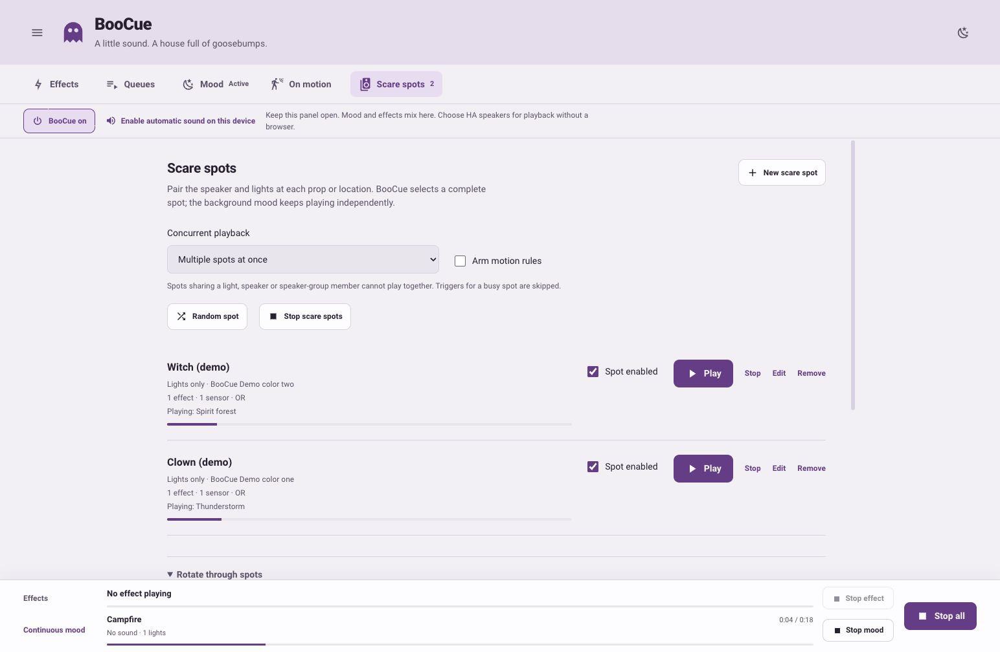
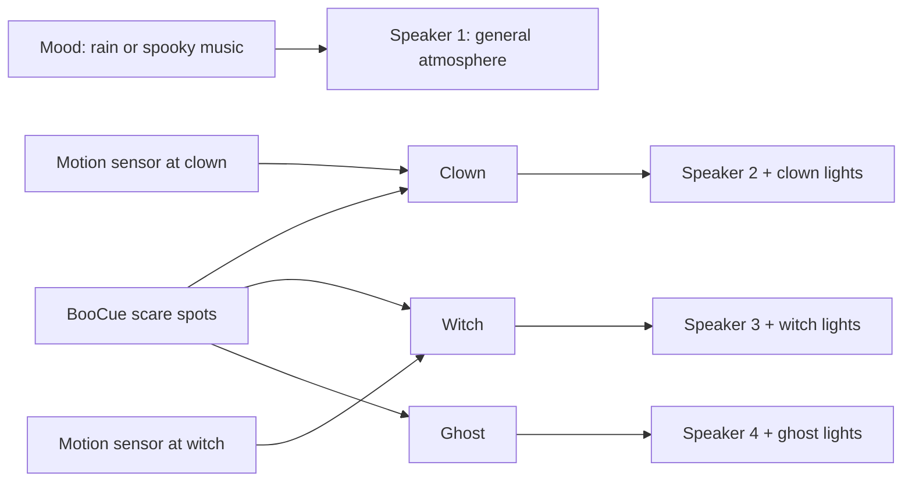

# Scare spots



*The example uses virtual lights. Select HA speakers in each spot for audio at the prop.*

A scare spot pairs the speaker, lights and sound effects at one prop or location. The background atmosphere remains on its own mood speakers. Choosing a random spot chooses its complete sound-and-light setup together.



## Set up a haunted house

1. Open **Mood**, choose the background atmosphere and select its general speaker(s). Start it independently. Leave its light selection empty if it should only provide background sound.
2. Open **Scare spots → New scare spot**. Name it, for example, **Clown**.
3. Select the speaker(s) and lights physically beside the clown. Choose one or more foreground effects and random or fixed-order effect selection. Set this spot's volume and brightness.
4. Optionally select its motion sensor(s), OR/AND matching and cooldown, then save the spot.
5. Repeat for **Witch**, **Ghost** or other locations. Use the Play button to trigger a saved spot, or **Random spot** to choose an available enabled location.

A spot uses HA speakers or lights only. Browser audio remains available for the ordinary mood/effect channels; physical spots and their loops do not need an open browser.

Spot settings override per-effect speaker routes so that an effect always stays with the selected prop's own lights and speakers. An effect pool can be shared by several spots without changing where each spot plays.

## One at a time or several together

Use **Concurrent playback**:

- **One scare spot at a time:** a new spot trigger is skipped while another foreground effect or spot is playing. The mood continues independently.
- **Multiple spots at once:** different spots can play together using their own speakers and lights. Each has its own start, stop, volume and light restoration.

Even in parallel mode, two foreground runs cannot own the same lamp, speaker or overlapping speaker-group member. A busy motion trigger is skipped rather than queued for later. A random manual start tries another available enabled spot. Dedicated hardware for each prop gives the most predictable result.

The background mood can share lights with a spot: its lighting pauses on those lamps while the foreground effect takes priority and resumes afterwards. For overlapping audio on the same speaker, the usual compatible-Sonos announcement rules apply; other players need separate mood/effect destinations.

Changing from parallel to single mode stops additional foreground runs so that only one remains. This does not stop the atmosphere.

## React to motion

Assign sensors in each spot and arm **Motion rules**. Spots use the same global motion-arming switch as the existing **On motion** rules.

Only `off` → `on` counts. A sensor remaining on, HA startup, or recovery from unknown/unavailable does not trigger a scare. OR accepts either selected sensor; AND requires all selected sensors to be on when a new edge arrives. Each spot has its own cooldown, measured from its last accepted motion start.

Do not create a second built-in rule or HA automation for the same sensor/spot unless two separate actions are intended. Turning motion arming off prevents future motion starts; it does not stop a timed loop already running.

## Loop through locations

Under **Rotate through spots**, select all enabled spots or a specific subset. Choose random or fixed order, repeat and the shortest/longest pause. Save and start the loop.

The loop plays its own locations **one after another**, waiting for each sound to finish before the pause. Shuffle visits each selected spot once per cycle and avoids an immediate repeat where possible. The spot chooses its own effect from its saved pool.

In parallel mode, a motion sensor or manual action may trigger another free spot while the loop is playing. A busy spot is skipped on that loop pass; its effect-selection position is not consumed. No backlog of delayed motion scares is created.

**Stop loop** stops its current owned spot effect and leaves independent motion effects and the background mood running. **Stop scare spots** stops all physical spot effects and their loop while leaving mood and motion arming unchanged. **Stop all** also stops mood and disarms motion. The master Off blocks all new starts. Loops do not resume automatically after an HA restart.

## Home Assistant actions

The spot editor exposes its ID under **Home Assistant automations**. Copy that ID into an automation action:

```yaml
action: boocue.spot_play
data:
  spot_id: your-clown-spot-id
```

Choose a random available enabled spot:

```yaml
action: boocue.spot_play
```

Start or stop the saved location loop:

```yaml
action: boocue.spot_show_start
```

```yaml
action: boocue.spot_show_stop
```

Stop one physical spot:

```yaml
action: boocue.spot_stop
data:
  spot_id: your-clown-spot-id
```

Omit `spot_id` from `boocue.spot_stop` to stop all spot effects and the loop, while keeping the background atmosphere. Existing global power, activity/status entities and Stop all controls include scare-spot playback and loops waiting for their next item.
